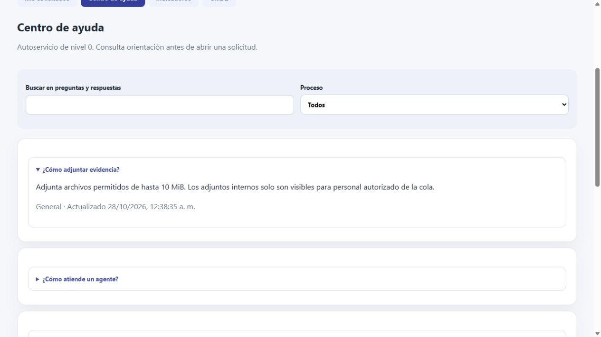
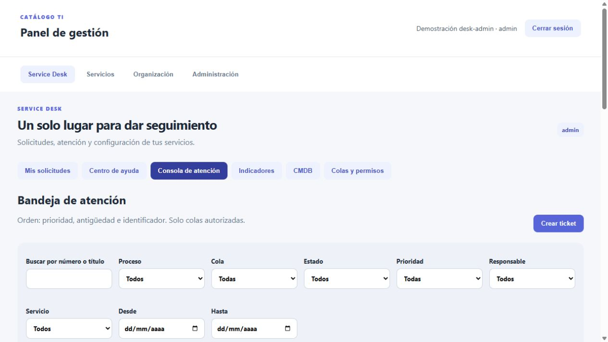

# Demostración de Service Desk

Verificado el 28 de octubre de 2026, zona America/Guatemala. Autor del proyecto: Jeremy Estuardo Orellana Aldana, carné 202300644.

## Dónde entrar

Demostración limpia en la laptop: [192.168.1.23:18090](http://192.168.1.23:18090/). En la propia laptop: [localhost:18090](http://localhost:18090/).

Este entorno tiene base `catalogo_desk_demo`, proyecto Compose `catalogo-service-desk-demo` y volúmenes propios. No sustituye el entorno anterior de puerto 18080 ni la base del parcial original. Las pruebas finales usan otro proyecto, `catalogo-final-test`, con puertos 18180 y 18181.

## Cuentas preparadas

| Usuario | Rol | Qué demostrar |
| --- | --- | --- |
| `desk-admin` | Administrador | FAQ, CMDB, colas y configuración |
| `desk-solicitante` | Solicitante | Sus 37 solicitudes, comentarios públicos y FAQ |
| `desk-agente1` | Agente | Atención de tickets preparados y transiciones |
| `desk-agente2` | Agente | Segunda identidad para reclamación y asignación |
| `desk-aprobador` | Aprobador | Decisiones de acceso, cambio y nuevo servicio |
| `desk-consulta` | Consulta | Lectura sin escrituras, incluso con permisos de cola |

La contraseña se suministra mediante `DESK_DEMO_PASSWORD` al preparar la demostración. No se toma de las credenciales históricas del catálogo ni se guarda en este documento. Las cuentas solo son sintéticas y no deben exponerse a Internet.

La carga rechaza una cuenta existente con contraseña o roles diferentes. No restablece credenciales ni eleva roles silenciosamente. También exige habilitación explícita y una base cuyo nombre termine en `_desk_demo` o `_desk_test`.

## Datos realmente cargados

| Proceso | Tickets | Casos preparados |
| --- | --- | --- |
| Nuevos servicios | 5 | Solicitado, análisis, pendiente de aprobación, implementación y cerrado |
| Cambios | 5 | Solicitado, evaluación, pendiente de aprobación, ejecución y cerrado |
| Incidentes | 7 | Uno por categoría I0–I6, con pausa, recuperación, cierre y reapertura |
| Eventos | 5 | E0–E3, con E0 adicional cerrado y vínculos E2/E3 a un incidente existente |
| Problemas | 5 | Registro, investigación, causa, solución propuesta y cerrado |
| Accesos | 5 | Solicitado, validación, pendiente, provisión y rechazo |
| Servicios existentes | 5 | Solicitado, validación, asignado, cumplimiento y cerrado |
| **Total** | **37** | Siete colas, una por proceso |

Además hay 5,000 dispositivos generados con dataset `demostracion-5000`, semilla `20261028`, y ocho artículos publicados. Los 37 tickets tienen títulos `[DEMO]`, motivo explícito de ausencia de CI y datos ficticios declarados. Los nuevos servicios vinculan un servicio ya existente como resultado de demostración, no crean registros adicionales en el catálogo de 12/46. Las notificaciones E2/E3 enlazan un incidente preparado, por eso no aumentan el total.

`demo_tickets` relaciona cada caso estable con su ticket. `prepared_at` indica que terminó su preparación. Repetir el comando no reinicia los tickets ya preparados. Un caso interrumpido puede continuar desde su estado actual. No ejecutar acciones manuales sobre una preparación incompleta.

## Preparación desde cero

En una terminal Bash de la laptop, dentro del repositorio:

```bash
docker compose -p catalogo-service-desk-demo -f compose.desk-demo.yaml up --build -d
read -rs -p 'Contraseña sintética de al menos 12 caracteres: ' DESK_DEMO_PASSWORD
export DESK_DEMO_PASSWORD
docker compose -p catalogo-service-desk-demo -f compose.desk-demo.yaml exec -T -e SEED_ADMIN_PASSWORD="$DESK_DEMO_PASSWORD" -e SEED_CONSULTA_PASSWORD="$DESK_DEMO_PASSWORD" api ./catalogo-seed
docker compose -p catalogo-service-desk-demo -f compose.desk-demo.yaml exec -T -e DESK_DEMO_ALLOW_WRITE=1 -e DESK_DEMO_PASSWORD="$DESK_DEMO_PASSWORD" api ./desk-demo
bash scripts/service-desk-demo-verify.sh
```

Esperar a que la API esté lista antes del seed. Si todavía está arrancando, consultar `docker compose -p catalogo-service-desk-demo -f compose.desk-demo.yaml logs api` y repetir cuando responda `/api/ready`.

El seed inicial importa el catálogo y crea organización y cuentas históricas. No repetirlo para restaurar una demostración ya editada porque sincroniza esos datos. Para comprobar repetibilidad del conjunto de tickets basta ejecutar otra vez `./desk-demo` con las mismas variables. El generador agrega dispositivos faltantes y conserva los códigos existentes con `ON CONFLICT DO NOTHING`, no restaura sus ediciones manuales ni reactiva registros de forma silenciosa.

La preparación también registra las dos filas originales de CMDB. Como administrador se pueden consultar en **CMDB → Origen del Excel**, con 20 campos por fila, coordenadas y hash. Esta vista no convierte automáticamente los ejemplos en CI operativos ni resuelve las referencias incompletas.

Salida real del comando:

```json
{"by_process":{"accesos":5,"cambios":5,"eventos":5,"incidentes":7,"nuevos":5,"problemas":5,"servicios":5},"dataset":"desk-v1","faq":8,"queues":7,"tickets":37}
```

La [salida completa](evidencias/service-desk-demo-salida.txt) muestra dos comprobaciones con los mismos digest de tickets e historial antes y después de repetir la preparación. El verificador es de solo lectura y falla si ya no hay exactamente 37 tickets o siete colas. No repara ni borra datos.

## FAQ y recorrido breve

1. Iniciar sesión como solicitante y abrir **Centro de ayuda**.
2. Abrir una pregunta y buscar `acceso`. Solo aparece el artículo coincidente.
3. Como administrador, abrir **Centro de ayuda** y editar un artículo. El formulario carga sus valores. Publicación y baja son explícitas, con control de versión e historial inmutable.
4. Como aprobador, localizar `SD-00000030`, `SD-00000015` o `SD-00000010`, pendientes de decisión.
5. Como agente, abrir `SD-00000004` para mostrar su pausa y `SD-00000006` para mostrar el ciclo 2.

Los números corresponden a esta base nueva y están respaldados por el recibo SQL. La FAQ requiere sesión. No es un sitio anónimo ni expone comentarios o adjuntos internos. El contenido de ayuda es orientación del proyecto, no una transcripción de ITIL.





## Límites de esta entrega

Las pruebas funcionales y P18 están en [verificación final](evidencias/service-desk-final.md). P04 sigue limitado por falta de confirmación de la taxonomía exacta de la lección 22. No se presenta el conjunto de datos ni las pruebas aprobadas como certificación de ese requisito documental.
