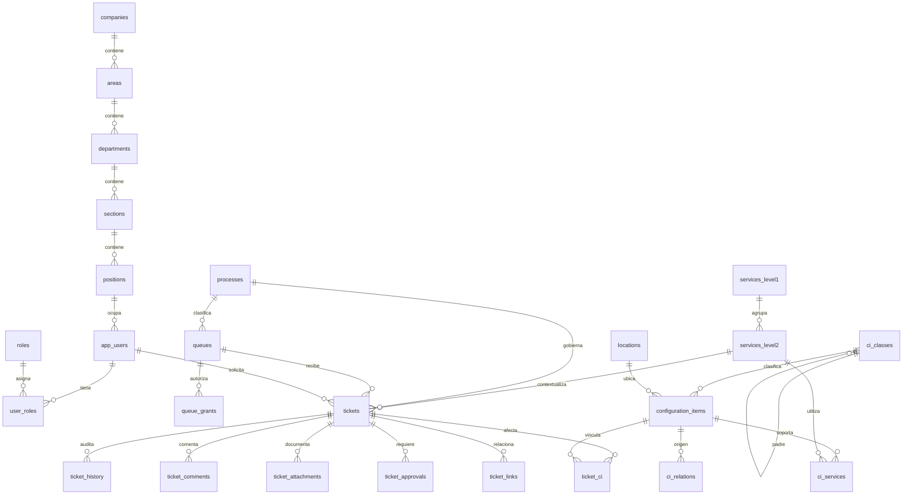

# Modelo de Service Desk y CMDB

Fecha: 2026-10-27. Estado: diseño propuesto, todavía sin migraciones ni implementación nueva. El enunciado manda sobre esta propuesta. Las decisiones complementarias se identifican explícitamente.

Actualización de implementación: la migración 004 y API ya implementan la base funcional. Las diferencias respecto a este diseño inicial se explican en [API-SERVICE-DESK](API-SERVICE-DESK.md), especialmente JSONB por proceso, PK de roles y estados/rutas. El resto de este documento conserva la propuesta de diseño, no es un inventario literal de tablas aplicadas.

## Base conservada y arquitectura

Go, React/Vite y PostgreSQL, monolito modular Controller → Service → Repository. Reutilizar `companies`, `areas`, `departments`, `sections`, `positions`, `app_users`, `sessions`, catálogo y trazabilidad de importación. Mantener la jerarquía y controles 12/46 de origen, no confundirlos con el total tras altas manuales. No reescribir migraciones aplicadas ni mover `parcial-v2.0`.

Módulos nuevos previstos: identidad y permisos ampliados, CMDB, tickets, flujos, colas, conocimiento, indicadores y datos de demostración. Las transacciones coordinan repositorios desde servicios, no desde handlers.

## Diagrama de relaciones principales

Diagrama previo a programar. Las tablas de detalle y soporte se describen en el diccionario.

## Convenciones del diccionario

PK nuevas: `bigint identity`, salvo tablas puente con PK compuesta. Referencias: FK explícitas con borrado RESTRICT de datos funcionales e históricos. Fechas de acciones: `timestamptz` en UTC. Fechas del Excel: `date` nullable. Cadenas obligatorias no vacías tras trim. Ausencia no equivale a cero. `created_at`, `updated_at` e `is_active` en entidades mantenibles, sin eliminar su historial. Las tablas de historial son de inserción y consulta, sin edición desde la aplicación.

### Identidad, colas y flujos

| Entidad prevista | Campos y relaciones principales | Restricciones |
| --- | --- | --- |
| `roles` | id, code text, name | code único, admin, consulta, solicitante, agente, aprobador |
| `user_roles` | user_id FK app_users, role_id FK roles | PK compuesta, migrar roles actuales sin pérdida |
| `processes` | id, code, name, ticket_type, subtype | siete códigos únicos, mapeo en PROCESOS |
| `support_levels` | id, code, name, rank, next_level_id FK propia | code/rank únicos, ruta sin ciclos |
| `queues` | id, code, name, description, process_id FK, support_level_id FK, ordering_rule, first_response_minutes, resolution_minutes, calendar_mode | código único, un proceso obligatorio, objetivos positivos o NULL, orden validado |
| `queue_grants` | id, queue_id FK, user_id FK nullable, role_id FK nullable, can_read, can_handle, can_transfer, can_approve, can_admin | exactamente un sujeto usuario o rol por fila, unicidad por sujeto y cola |
| `workflow_states` | id, process_id FK, code, terminal, pauses_clock | único process/code |
| `workflow_transitions` | id, process_id, from_state_id, to_state_id, action, required_permission, guard_code | FK compuestas para mantener proceso, regla validada en Service |

Ampliación de roles: reemplazar el CHECK limitado a admin/consulta de forma compatible. Durante transición, evitar dos fuentes de permisos contradictorias. La API y la interfaz deben migrar juntas a roles múltiples. Consulta es una restricción efectiva de solo lectura aunque se combine con otros roles o grants. Ver política en PROCESOS.

### Tickets y trazabilidad

| Entidad prevista | Campos y relaciones principales | Restricciones |
| --- | --- | --- |
| `tickets` | id, number text, title, description, requester_id y creator_id FK app_users, service_level2_id FK, process_id FK, type, subtype, queue_id FK, assignee_id FK nullable, state_id FK, priority, impact, urgency, channel, resolution text nullable, no_ci_reason text nullable, version bigint, first_attended_at, resolved_at, closed_at | number único generado por secuencia, cola/estado del mismo proceso, cierre con resolución o motivo de rechazo, versión para concurrencia |
| `ticket_history` | id, ticket_id FK, actor_id FK, action, occurred_at, before jsonb, after jsonb, reason, correlation_id | solo inserción, cambio e historial en misma transacción |
| `ticket_comments` | id, ticket_id FK, author_id FK, body, visibility public/internal, created_at | notas internas fuera de respuestas al solicitante |
| `ticket_attachments` | id, ticket_id FK, uploader_id FK, original_name, storage_key, mime_type, byte_size, sha256, visibility, created_at | Implementado en migración 005 con storage_key único y tamaño de 1 byte a 10 MiB. La asociación opcional a comentarios del diseño inicial no está implementada |
| `ticket_ci` | ticket_id FK, ci_id FK | PK compuesta, no duplicar vínculo |
| `ticket_links` | id, source_id y target_id FK tickets, kind | no autorrelación, único source/target/kind, tipos controlados y orientación documentada |
| `ticket_approvals` | id, ticket_id FK, cycle integer, approver_id FK, decision, reason, decided_at | aprobación específica del ciclo actual, accesos con aprobador distinto del solicitante |
| `ticket_pauses` | id, ticket_id FK, started_at, ended_at nullable, reason, actor_id FK | fin >= inicio, una pausa abierta por ticket |
| `ticket_cycles` | id, ticket_id FK, cycle_no, started_at, resolved_at nullable, closed_at nullable | único ticket/cycle, conserva ciclos al reabrir |
| `ticket_objective_segments` | id, ticket_id, cycle, queue_id, started_at, ended_at, first_response_minutes, resolution_minutes, source | Implementado en 006. FK al ciclo, objetivos positivos o NULL y un tramo abierto por ticket. Histórico anterior marcado como desconocido |
| `event_incidents` | event_ticket_id PK/FK tickets, incident_ticket_id FK tickets | una asociación automática por evento, validación de procesos |
| `notifications` | id, ticket_id FK, recipient_id FK, kind, dedup_key, read_at nullable | dedup_key única, autorización de lectura |

Nivel 1 siempre derivado desde el servicio nivel 2, no una FK editable independiente. Para nuevos servicios, vincular la solicitud a un nivel 2 existente usado como contexto y registrar `proposed_service_name` y `result_service_id` separado. No crear un servicio ficticio antes de aprobación. Si no existe un servicio de contexto válido, se necesita decisión humana en vez de inventarlo.

Detalles por proceso en tablas 1:1 con PK/FK ticket_id: `new_service_details` (necesidad, viabilidad, propuesta, result_service_id), `change_details` (impacto, riesgo, planificación, plan de pruebas, reversión, resultado de ejecución y validación), `incident_details` (categoría, interrupción/degradación, duraciones estimada y real nullable, redundancia nullable, solución), `event_details` (E0–E3, external_key única nullable, evaluación), `problem_details` (causa raíz, workaround, known_error, solución definitiva), `access_details` (beneficiary_id FK, recurso, permiso, grant/revoke, evidencia), `fulfillment_details` (petición, validación, cumplimiento, confirmación).

### CMDB

| Entidad prevista | Campos y relaciones principales | Restricciones |
| --- | --- | --- |
| `ci_classes` | id, code, name, parent_id FK propia nullable, allowed_attributes jsonb, is_device_class | code único, padre activo, no autorreferencia ni ciclos indirectos |
| `locations` | id, code, name, description | código único, registros sintéticos identificados |
| `configuration_items` | id, code, name, class_id FK, description, serial_number nullable, version nullable, acquired_on date nullable, status, location_id FK, owner_user_id FK, security_level nullable, compliance nullable, configuration_status nullable, license_number nullable, license_expires_on nullable, technical_attributes jsonb, is_device boolean, review_required, dataset_key nullable, seed nullable | código único, clase activa, atributos según clase, ninguna IP universalmente obligatoria |
| `ci_relations` | id, source_ci_id FK, target_ci_id FK, relation_type_id FK | no autorrelación, único origen/destino/tipo, ciclos según tipo |
| `ci_relation_types` | id, code, name, allows_cycles, propagates_impact | code único, reglas no editables sin revalidar relaciones |
| `ci_services` | ci_id FK, service_level2_id FK | PK compuesta |
| `ci_changes` | id, ci_id FK, actor_id FK nullable para importado, occurred_at nullable, description, before/after jsonb, source_ref | historia importada sin inventar actor, acciones nuevas con actor |
| `ci_documents` | id, ci_id FK, title, url, source_ref, is_placeholder | URL validada, placeholders no convertidos en adjuntos descargables |
| `source_records` | id, source_file, sha256, sheet, row_start/end, range, raw_values jsonb, normalized_values jsonb, observations jsonb, target_kind/id nullable | conservar origen y transformaciones, resolver destino en Service |
| `generation_runs` | id, dataset_key, seed bigint, generator_version, requested_count, actual_count, status, started_at, finished_at, summary jsonb | único dataset/seed/version para conjunto determinista, ejecuciones repetidas trazables |
| `faq_articles` | id, slug único, title, body, process_code y service_level2_id FK nullable, is_published, is_active, version, created_by y updated_by FK | migración 008, publicadas activas visibles con sesión, sin notas privadas |
| `faq_history` | article_id FK, actor_id FK, before_value, after_value, occurred_at | historial inmutable, misma transacción que el artículo |
| `demo_tickets` | dataset_key y case_key PK, ticket_id FK único, prepared_at | 37 casos estables, repetición sin duplicación ni reinicio |

Los campos operativos obligatorios agregados no deben forzar valores inventados en los dos ejemplos. Importarlos primero a `source_records` con revisión cuando no se pueda resolver clasificación, ubicación o responsable. Los 5,000 dispositivos sintéticos sí cumplen todas las referencias. Los ejemplos no se cuentan como dispositivos válidos hasta resolver sus faltantes.

## Mapeo del Excel CMDB

Hoja CMDB, encabezados B4:U4, ejemplos filas 5–6. Conservar valores originales y espacios/codificación en `source_records`, aplicar trim solo a versión normalizada. No alterar el archivo.

| Columna | Campo original | Destino propuesto |
| --- | --- | --- |
| B | Nombre del CI | configuration_items.name |
| C | Tipo de CI | ci_classes, mapeo Hardware/Software conservado |
| D | Descripción | configuration_items.description |
| E | Número de Serie | serial_number nullable |
| F | Versión | version nullable |
| G | Fecha de Adquisición | acquired_on, error de parseo como observación |
| H | Estado Actual | status, catálogo controlado sin inventar etiquetas fuente |
| I | Relaciones | ci_relations solo al resolver referencias, conservar texto si no |
| J | Padres/Hijos | revisión de naturaleza del vínculo antes de importarlo, no inferir clasificación |
| K | Ubicación Física | location_id o propuesta de relación alojado_en pendiente de revisión |
| L | Propietario/Responsable | owner_user_id al resolver, conservar equipo textual de origen |
| M | Fecha de Cambio | ci_changes.occurred_at, fecha fuente |
| N | Descripción del Cambio | ci_changes.description |
| O | Documentación relacionada | ci_documents, marcador `(url)` identificado |
| P | Enlaces a Incidentes y Problemas | ticket_ci solo al resolver tickets, marcador conservado |
| Q | Niveles de Seguridad | security_level |
| R | Cumplimiento | compliance |
| S | Estado de Configuraci√≥n | configuration_status, normalización de encabezado registrada |
| T | N√∫mero de Licencia | license_number nullable, corrección de encabezado registrada |
| U | Fecha de Vencimiento | license_expires_on nullable |

Campos añadidos por la tarea/proyecto: id, code, auditoría, dataset/seed, ubicación y responsable referenciados, indicador de dispositivo, metadatos de clasificación, atributos técnicos estructurados y estado de revisión. No se atribuyen al Excel.

## Clasificación y relaciones: decisión complementaria

El material recibido no enumera una taxonomía completa. Se implementó un bosque configurable con raíces Hardware y Software, que sí aparecen en el Excel. Como extensiones propias se implementaron Hardware → Servidor, Equipo de usuario, Red, Impresión, Almacenamiento y Energía. Software permanece para aplicaciones y no integra el conteo de dispositivos. No es una transcripción docente. Tras la aclaración de Jeremy, no se trata un árbol adicional no enumerado como desarrollo pendiente. La [decisión de P04](decisiones/002-interpretacion-cmdb-p04.md) registra el alcance acordado y la salvedad interpretativa, sin afirmar que las fuentes contienen esas seis subclases.

Antes de insertar o mover una clase, bloquear cambios de clasificación en transacción y recorrer ancestros. Rechazar padres inexistentes/inactivos y ciclos. No reutilizar la organización como árbol de clases.

Relaciones técnicas propuestas: `depende_de` y `alojado_en` dirigidas sin ciclos, `conectado_a` simétrica con ciclos permitidos. Para las simétricas guardar par ordenado por ID y unicidad. Para vínculos sin ciclos, usar bloqueo transaccional por tipo y búsqueda de camino inverso antes de insertar. Los tipos que propagan posible impacto se recorren de dependido a dependientes, con conjunto de visitados, límite de profundidad y aviso de truncamiento. Resolver los servicios asociados a esos CI, devolver rutas y distinguir impacto potencial de interrupción efectiva.

## Generación y rendimiento previstos

Conjunto `cmdb-demo`, semilla configurable y versión de generador. Código determinista por conjunto/semilla/ordinal, upsert del mismo conjunto sin borrar otros datos. Por defecto exactamente 5,000 dispositivos Hardware distribuidos en las seis clases propias, con referencias activas preexistentes. Software, componentes, relaciones y catálogos no cuentan. Reportar COUNT de dispositivos distintos por clase y ancestros sin sumar subtotales como si fueran dispositivos extra. Medir tiempos realmente en la laptop al implementar, no estimarlos como evidencia.

Índices previstos: código único CI, clase/estado/id, ubicación, responsable, relaciones por origen/destino/tipo, tickets por cola/estado/prioridad/fecha/id y solicitante/fecha. API con paginación estable y límite máximo 100. Revisar EXPLAIN y mediciones reales sobre 5,000 dispositivos en P16. Generación y borrado explícito de datasets son operaciones separadas del arranque normal.
