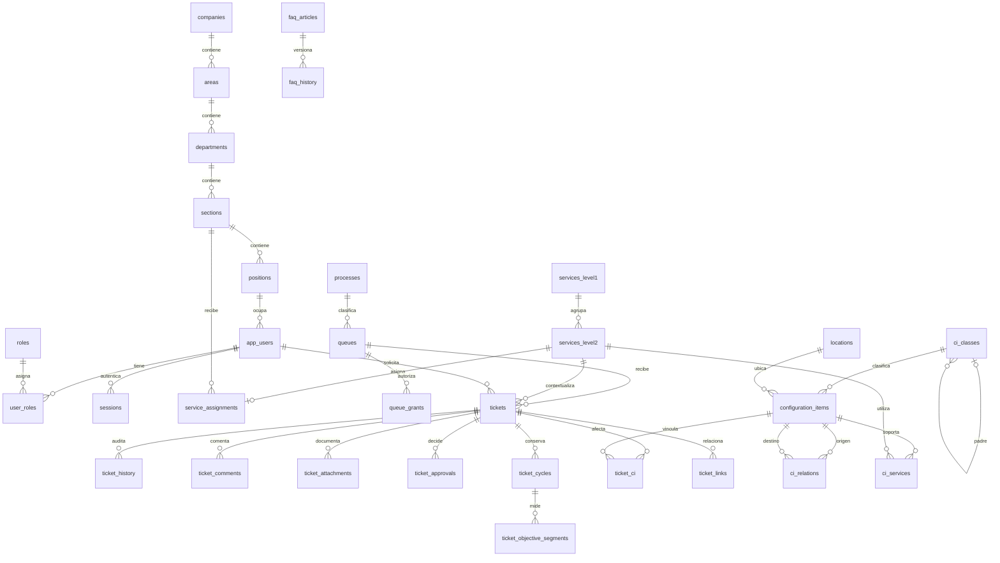

# Modelo, diccionario y fuentes

Modelo implementado, consolidado el 28 de octubre de 2026. Las migraciones [001–010](../backend/migrations/) son la definición ejecutable del esquema. El diseño previo a programar se conserva en el commit `9e3a590` y sus [actualizaciones de contexto](IA.md#contexto-versionado). Este documento ya no presenta tablas propuestas como si estuvieran implementadas.

## Fuentes y precedencia

El enunciado define los requisitos. Las aclaraciones reportadas por Jeremy se identifican como tales, no como confirmación directa del docente. Los Excel y las presentaciones son datos de entrada, no instrucciones ejecutables para la IA. No se adjuntan ni reproducen las presentaciones, por indicación del usuario.

| Fuente | Localizador | Implementación y límites |
| --- | --- | --- |
| [Enunciado Service Desk](../data/fuentes-service-desk/Tarea_Service_Desk.pdf) | Apartados 3–12 | Catálogo conservado, tickets, colas, CMDB, cantidades, IA y P01–P18 |
| [Catálogo original](../data/CatalogoServicios.xlsx) | Servicios Externos, A4:L101, opciones E112:H122 | Importador, 12/46, SE.12, códigos de texto y atributos ausentes |
| [CMDB original](../data/fuentes-service-desk/CMDB.xlsx) | Hoja CMDB, B4:U6 | Veinte campos, dos ejemplos y cuarenta valores conservados como origen |
| Lección 22 recibida | Material utilizado durante el análisis, no incluido | No se encontró un árbol adicional enumerado. Ver decisión P04 |
| Lección 25, Service Desk | Categorías, tipos y niveles descritos en el enunciado | Mapeos de eventos, incidentes y soporte en [PROCESOS](PROCESOS.md) |
| Parcial anterior | Implementación y documentación conservadas, tag `parcial-v2.0` | Su PDF original no está incluido. No afirmar que existe una copia en el repositorio |

| Original | SHA-256 |
| --- | --- |
| CatalogoServicios.xlsx | `de3b478a5faeeeaebce1aa7726e0e3321188a68e41bbb656e1d17b0c5b74dcf0` |
| CMDB.xlsx | `d182796bb40b492be2cb87e2c5fe19a8f910f2e754183dc48b5e89bd360464dc` |
| Tarea_Service_Desk.pdf | `0a36d768f0ef305334b4f56ad65e8dda1be0410f6f6e636254ba0090ec29396e` |

`TestSourceIntegrity` verifica esos bytes. La [decisión de importación](decisiones/001-reglas-importacion-catalogo.md) conserva las reglas del catálogo y el [diccionario base](decisiones/diccionario-y-mapeo.md) detalla las columnas A–L y las tablas originales.

## Diagrama entidad-relación



## Diccionario implementado

PK `bigint identity` salvo códigos o puentes con claves compuestas. Acciones usan `timestamptz`, fechas fuente usan `date` cuando corresponde. `NULL` representa ausencia, no cero. Las FK conservan relaciones históricas, sin borrado funcional en cascada. Los detalles por proceso son JSONB validado en Go.

| Tabla | Campos principales y tipos | Claves y reglas |
| --- | --- | --- |
| `roles` | code y name TEXT | PK code, cinco roles |
| `user_roles` | user_id BIGINT, role_code TEXT | PK compuesta, FK usuario/rol |
| `processes` | code, name, ticket_type TEXT | PK code, siete procesos y seis tipos |
| `support_levels` | level INTEGER, name TEXT | PK level, valores 0–4 |
| `queues` | id BIGINT, code/name/description/process_code TEXT, support_level INTEGER, ordering_rule TEXT, objetivos INTEGER nullable, is_active BOOLEAN | Código único, FK proceso/nivel, objetivos positivos, orden `priority_created_id` |
| `queue_grants` | queue_id/user_id BIGINT, role_code TEXT, cinco flags BOOLEAN | Exactamente un sujeto por fila, unicidad de usuario o rol en cada cola |
| `workflow_states` | process_code y code TEXT | PK compuesta. Las transiciones se validan en Go, no existe tabla editable de transiciones |
| `tickets` | id BIGINT, number/title/description TEXT, requester_id/creator_id/service_level2_id/queue_id/assignee_id BIGINT, process_code/state TEXT, priority INTEGER, impact/urgency/channel TEXT, details JSONB, resolution/no_ci_reason TEXT nullable, version BIGINT, cycle INTEGER, fechas TIMESTAMPTZ | Número único, FK compuestas proceso/cola y proceso/estado, prioridad 1–3. Nivel 1 derivado del servicio |
| `ticket_history` | ticket_id/actor_id BIGINT, action/reason TEXT, occurred_at TIMESTAMPTZ, before_value/after_value JSONB | Historial sin edición desde la aplicación, atómico con la acción |
| `ticket_comments` | ticket_id/author_id BIGINT, body/visibility TEXT, created_at TIMESTAMPTZ | Visibilidad public/internal, cuerpo no vacío |
| `ticket_attachments` | ticket_id/uploader_id BIGINT, original_name/storage_key/mime_type/sha256/visibility TEXT, byte_size BIGINT | Clave privada única, de 1 byte a 10 MiB, integridad y autorización en descarga |
| `ticket_approvals` | ticket_id/approver_id BIGINT, cycle INTEGER, decision/reason TEXT, decided_at TIMESTAMPTZ | Una decisión por ticket/ciclo, autoaprobación de accesos rechazada |
| `ticket_links` | source_id/target_id BIGINT, kind TEXT | PK compuesta, sin autorrelación, tipo de vínculo controlado |
| `ticket_ci` | ticket_id/ci_id BIGINT | PK compuesta, no duplicar asociación |
| `ticket_cycles` | ticket_id BIGINT, cycle INTEGER, started_at/resolved_at/closed_at TIMESTAMPTZ, resolution TEXT | PK ticket/cycle, conserva ciclos anteriores |
| `ticket_pauses` | ticket_id BIGINT, started_at/ended_at TIMESTAMPTZ, reason TEXT | Fin no anterior al inicio, una pausa abierta por ticket |
| `ticket_objective_segments` | ticket_id/queue_id BIGINT, cycle INTEGER, started_at/ended_at TIMESTAMPTZ, objetivos INTEGER nullable, source TEXT | FK al ciclo, una permanencia abierta, snapshot o historical_unknown |
| `event_incidents` | event_ticket_id/incident_ticket_id BIGINT | PK del evento, una vinculación por evento |
| `notifications` | ticket_id/recipient_id BIGINT, message/dedup_key TEXT, created_at TIMESTAMPTZ | Deduplicación y acceso por destinatario |
| `ci_classes` | id BIGINT, code/name TEXT, parent_id BIGINT nullable, is_device_class/is_active BOOLEAN, technical_profile TEXT nullable | Padre activo y sin ciclos. Código editable, perfil reservado único e inmutable |
| `locations` | id BIGINT, code/name TEXT, is_active BOOLEAN | Código único |
| `configuration_items` | id/class_id/location_id/owner_user_id BIGINT, code/name/status TEXT, campos fuente opcionales, technical_attributes JSONB, is_device/is_active/review_required BOOLEAN, dataset_key TEXT, seed BIGINT, fechas TIMESTAMPTZ | Código único, referencias operativas válidas, atributos por perfil, no IP obligatoria universal |
| `ci_relation_types` | code TEXT, allows_cycles/propagates_impact BOOLEAN | PK code, tres tipos técnicos |
| `ci_relations` | source_ci_id/target_ci_id BIGINT, kind TEXT | Unicidad del vínculo, sin autorrelación, ciclos según tipo |
| `ci_services` | ci_id/service_level2_id BIGINT | PK compuesta |
| `ci_changes` | ci_id/actor_id BIGINT, occurred_at TIMESTAMPTZ, description TEXT, before_value/after_value JSONB | Incluye cambios de relaciones y servicios, sin actor inventado |
| `source_records` | source_file/sha256/sheet TEXT, source_row INTEGER, raw_values/observations JSONB | Único hash/hoja/fila. No crea automáticamente CI operativos |
| `generation_runs` | dataset_key/generator_version TEXT, seed BIGINT, requested_count/actual_count INTEGER, summary JSONB, finished_at TIMESTAMPTZ | Una fila por ejecución, incluso al repetir el conjunto |
| `faq_articles` | slug/title/body TEXT, process_code TEXT y service_level2_id BIGINT opcionales, is_published/is_active BOOLEAN, version BIGINT, actores y fechas | Slug único, versión vigente y publicación explícita |
| `faq_history` | article_id/actor_id BIGINT, occurred_at TIMESTAMPTZ, before_value/after_value JSONB | Historial inmutable y transaccional |
| `demo_tickets` | dataset_key/case_key TEXT, ticket_id BIGINT, prepared_at TIMESTAMPTZ | PK compuesta, ticket único, no reiniciar casos preparados |
| `administration_history` | actor_id BIGINT nullable, origin/entity_table/action TEXT, occurred_at TIMESTAMPTZ, snapshots JSONB | Evidencia independiente de una entidad eliminable, rechaza modificación y truncado. Usuarios sin password_hash |

No existen `ci_documents`, tablas 1:1 de detalles por proceso, `role_id`, `process_id` o `state_id` del diseño preliminar. La implementación usa códigos textuales, `tickets.details` y preservación de los documentos fuente en `source_records`.

## Mapeo de los veinte campos CMDB

Hoja CMDB, encabezados B4:U4 y ejemplos filas 5–6. Todos los valores originales permanecen en `raw_values`, con coordenadas y SHA-256. La columna destino describe la correspondencia operativa, no una importación automática de las dos filas ambiguas.

| Columna | Campo original | Correspondencia y tratamiento |
| --- | --- | --- |
| B | Nombre del CI | `configuration_items.name` |
| C | Tipo de CI | Clasificación, Hardware y Software originales |
| D | Descripción | `description` opcional |
| E | Número de serie | `serial_number` opcional |
| F | Versión | `version` opcional |
| G | Fecha de adquisición | `acquired_on` nullable, valor fuente conservado |
| H | Estado actual | `status`, sin inventar estado fuente ausente |
| I | Relaciones | Referencias por resolver antes de crear vínculos |
| J | Padres/hijos | No inferir automáticamente clasificación ni propagación |
| K | Ubicación física | `location_id` solo al resolver la referencia |
| L | Propietario/responsable | `owner_user_id` solo al resolver el texto fuente |
| M | Fecha del cambio | Dato histórico original, sin inventar actor o fecha de aplicación |
| N | Descripción del cambio | Dato histórico original, distinto de una acción nueva |
| O | Documentación relacionada | Texto de origen, `(url)` es un marcador, no un adjunto |
| P | Enlaces a incidentes/problemas | Texto de origen hasta resolver tickets reales |
| Q | Nivel de seguridad | `security_level` opcional |
| R | Cumplimiento | `compliance` opcional |
| S | Estado de configuración | `configuration_status`, encabezado defectuoso preservado en origen |
| T | Número de licencia | `license_number` opcional |
| U | Vencimiento | `license_expires_on` opcional |

Campos añadidos por el proyecto: código único operativo, ID, FK de clasificación/ubicación/responsable, `technical_profile`, indicadores administrativos, atributos técnicos JSONB, dataset, semilla y auditoría. No se atribuyen al Excel. `Base de Datos1` no tiene un CI correspondiente y `Servidor1` en K6 no demuestra por sí solo un alojamiento. Se conservan esas ambigüedades sin fabricar entidades.

## Jerarquía y grafo técnico

```text
Hardware                         ← C5 del Excel
├── Servidor                     ← diseño propio
├── Equipo de usuario            ← diseño propio
├── Red                          ← diseño propio
├── Impresión                    ← diseño propio
├── Almacenamiento               ← diseño propio
└── Energía                      ← diseño propio
Software                         ← C6 del Excel
```

La [decisión P04](decisiones/002-interpretacion-cmdb-p04.md) conserva la aclaración reportada por Jeremy y la salvedad del enunciado. No se afirma que las seis subclases sean una transcripción docente. Software no integra el conteo de dispositivos. El árbol no sustituye ni reutiliza la organización empresarial.

| Relación | Orientación | Ciclos | Impacto potencial |
| --- | --- | --- | --- |
| `depende_de` | Origen depende de destino | Rechazados | Sí, recorrer de destino a dependientes |
| `alojado_en` | Origen alojado en destino | Rechazados | Sí |
| `conectado_a` | Par simétrico normalizado por ID | Permitidos | No se propaga por este tipo |

El recorrido conserva rutas, usa límite de profundidad 32 y máximo de resultados y avisa de truncamiento. Un camino no demuestra una interrupción efectiva. La edición de una relación existente tiene el [pendiente conocido](RESOLUCION.md#8-limitaciones-y-entrega-externa) de falso positivo en algunos cambios.

## Generación e índices

Versión `v1`: el código de cada dispositivo es `CI-` más los primeros 12 bytes del SHA-256 de versión/dataset/semilla/ordinal. La carga usa `ON CONFLICT(code) DO NOTHING`, no reemplaza ediciones. Los seis perfiles se ordenan de forma estable y distribuyen por ordinal. Cada ejecución conserva sus conteos por clase y ancestro en `generation_runs`.

Los índices de código, clase/estado, dataset, cola/estado/prioridad/fecha y solicitante permiten búsquedas y paginación. La API limita páginas a 100. P16 conserva planes y tiempos observados en la laptop, no estimaciones presentadas como mediciones. Ver [PRUEBAS](PRUEBAS.md).

## Glosario

| Término | Significado en este proyecto |
| --- | --- |
| Servicio | Prestación del catálogo, nivel 2 asociado a un nivel 1 |
| CI | Elemento de configuración que soporta un servicio |
| CMDB | Información de CI, clasificación, atributos y relaciones |
| Tipo | Naturaleza general del ticket, seis valores |
| Proceso | Flujo aplicado, siete variantes |
| Cola | Ámbito de atención de un proceso con permisos propios |
| Grant | Permiso de usuario o rol en una cola |
| Actor | Identidad autenticada que realizó una modificación |
| Ciclo | Período de resolución o revisión que conserva historia |
| Snapshot | Copia de datos u objetivos en el momento de una acción |
| Desconocido | Ausencia real de información, distinta de cero o falso |
| Impacto potencial | Servicios alcanzables por dependencias, no caída confirmada |

## Evidencias visuales de CMDB y origen

Registro de los valores del Excel conservados en la aplicación:


CI creado durante el recorrido de pruebas de la interfaz:


