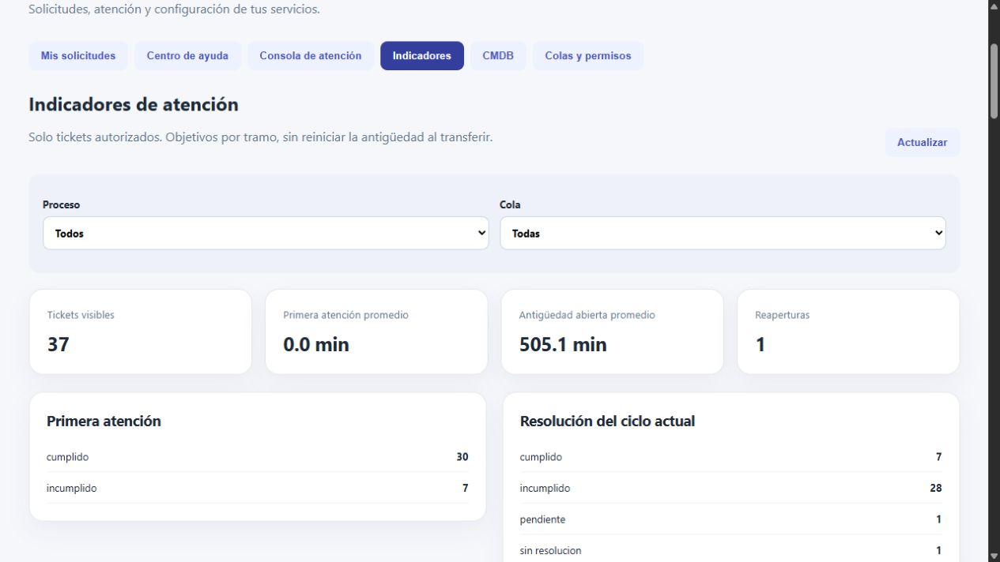

# Requisitos y plan de verificación de Service Desk

Inicio del plan: 2026-10-27. Actualización de resultados: 2026-10-28. Fuente principal: `data/fuentes-service-desk/Tarea_Service_Desk.pdf`. P01–P18 aquí son de Service Desk. La suite histórica P01–P12 del catálogo conserva sus nombres y resultados por separado. Los resultados actuales, comandos y límites están en la [verificación final](evidencias/service-desk-final.md).

## Matriz requisito → implementación → prueba → evidencia

La matriz relaciona requisitos y controles. Los resultados observados están en los recibos enlazados, no en una ejecución nueva de esta limpieza documental. Hay cobertura real del backend en la [evidencia de implementación](evidencias/service-desk-backend.md), [pruebas de adjuntos](evidencias/service-desk-adjuntos.md), [indicadores e interfaz](evidencias/service-desk-indicadores-interfaz.md) y [verificación final](evidencias/service-desk-final.md). P17 tiene fixtures unitarios y PostgreSQL con valores exactos. P18 ya tiene reinicio real y comparación de registros. La FAQ y los 37 tickets tienen pruebas y recibos propios. La interfaz tiene renderizado automatizado y recorrido real de navegador, que no se confunden con una suite E2E exhaustiva. P04 está verificado en el alcance disponible, con [cierre documental y salvedad interpretativa](decisiones/002-interpretacion-cmdb-p04.md) posteriores a la aclaración de Jeremy. No se simula otra ejecución ni se transforma esa aclaración en aprobación docente.

| Requisito del enunciado | Implementación | Prueba | Control y resultado esperado |
| --- | --- | --- | --- |
| Autenticación, sesiones, inactivos y permisos, §3/5/10 | Identidad ampliada y middleware por objeto/acción | P01 | HTTP esperado/real, sesión invalidada, cuentas inactivas, consulta con grants sin escritura |
| Importación 12/46, SE.12 y ausencias, §3 | Reutilizar importador y regresiones | P02 | Reporte generado, conteos por origen y hash del Excel, repetición sin duplicados |
| 5,000 dispositivos reales y semilla, §8 | Generador determinista y generation_runs | P03 | Conteo por clase/ancestro, unicidad y segunda carga, sin contar relaciones/software |
| Jerarquía, fuentes y ciclos, §2/8 | ci_classes, trazabilidad y bloqueo transaccional | P04 | Mapeo Excel/modelo, limitación de taxonomía explícita, padres inválidos, ciclo indirecto y concurrencia |
| Tickets y referencias, §4 | Tickets, detalles por proceso y validaciones | P05 | Alta válida, referencias inválidas/inactivas, nivel 1 derivado y sin CI justificado |
| Colas a roles y usuarios, §5 | queue_grants y permisos efectivos | P06 | Casos por usuario, rol, combinación, consulta y notas/descargas restringidas |
| Orden y doble reclamación, §5 | Orden estable, bloqueo y versión esperada | P07 | Empates reproducibles y dos conexiones sincronizadas, un éxito y un conflicto, una auditoría |
| Transferencias, §4/5 | Acción transaccional de transferencia | P08 | Before/after, motivo, destino activo, mismo proceso y responsable válido |
| Siete procesos distintos, §6 | Transiciones y guardas de PROCESOS.md | P09 | Una ruta completa por proceso y rechazo de saltos, también aprobado/rechazado |
| Cambios y accesos, §6 | Aprobación vigente por ciclo y segregación | P10 | Ejecución no aprobada y autoaprobación de solicitante/admin rechazadas |
| Eventos E0–E3, §7 | event_incidents y notificación con clave única | P11 | Respuesta por categoría, repetición y carrera E2/E3 sin incidentes/notificaciones duplicados |
| Incidentes I0–I6, §7 | Regla complementaria auditada | P12 | Fronteras 0/3/8/48/168/720 h, hueco, seguridad, NULL, negativos y redundancia real |
| Incidente, problema y cambio, §6 | ticket_links tipados | P13 | Recorrido recuperable, tipos válidos y causa/solución conservadas |
| Dependencias y ciclos técnicos, §8 | ci_relations y recorrido inverso | P14 | Camino CI→dependientes→servicios, ciclo permitido/rechazado según tipo, deduplicación y truncamiento |
| Resolución, cierre, reapertura y bitácora, §4 | Ciclos, transiciones e historial | P15 | Rechazo de cierre vacío, actor y fechas, ciclo nuevo sin pérdida de historial |
| Búsqueda/paginación y 5,000 CI, §4/8 | API paginada e índices | P16 | Filtros y páginas estables, tiempos reales, dataset, recursos/entorno y plan SQL |
| Indicadores, §7 | Agregados por ciclo, pausas y objetivos | P17 | Fixtures con valores exactos, abierto sin cero ficticio, reapertura, objetivo NULL, frontera y transferencia |
| Persistencia, §10 | Volúmenes PostgreSQL y adjuntos | P18 | Conteos y registros antes/después de reinicio, ticket, historial, CMDB y adjunto descargable |

## Coberturas adicionales obligatorias

No limitar la evaluación a los rótulos de P01–P18. Cubrir también:

- CRUD y bajas de colas, CI, clases y relaciones con dependencias sin huérfanos.
- Carga con al menos siete colas, 37 tickets propuestos y roles evaluables. Evidencia de cinco por proceso y siete categorías de incidentes.
- Portal del solicitante con solo sus tickets, consola de agentes por colas y FAQ pública autorizada.
- Filtros de tickets por número, servicio, proceso, cola, estado, prioridad, responsable y fechas, con paginación.
- Adjuntos con tamaño, tipo, rutas maliciosas, acceso directo e interno/público, y descarga autorizada.
- Notas internas fuera de respuestas JSON al solicitante y al rol consulta.
- Actualización crítica sin historial debe hacer rollback. No permitir edición o eliminación silenciosa del historial.
- Bajas de cola/usuario y revocación de permisos con tickets pendientes deben rechazarse o resolverse explícitamente.
- Construcción desde clon limpio, sin lenguajes instalados en anfitrión, sin claves de IA y sin secretos versionados.

## Niveles y aislamiento

Unitarias Go: permisos, transiciones, umbrales, objetivos y clasificación. Integración PostgreSQL/API: FK, idempotencia, concurrencia, auditoría atómica y persistencia. Navegador: portal, consola, FAQ, formularios y flujos representativos. No afirmar cobertura de navegador por tener solo pruebas HTTP.

Preparar un clon y proyecto Compose separados con base/volúmenes y puertos distintos. No usar la copia remota sucia ni la base del parcial como destino. Las pruebas crean y eliminan solo su dataset identificado o destruyen únicamente su entorno desechable explícito. No ejecutar `down -v` sobre evaluación habitual.

## Comandos y resultados

Despliegue posterior al merge: el commit `8a103ac` fue construido y probado desde un clon nuevo en la laptop. La demo fue actualizada conservando datos, reiniciada y comprobada en navegador. P18 se ejecutó explícitamente con descarga de adjunto antes y después del reinicio. [Evidencias y pendiente conocido](evidencias/service-desk-despliegue-final.md).

Actualización de cierre: la [ejecución desde clon limpio](evidencias/service-desk-cierre.md) verifica el commit publicado `0b5b8c7`, con comparación de los 40 valores de origen, negativas explícitas P10/P15 y build con integridad de fuentes. Las salidas anteriores conservan su SHA y fecha, no se reescriben para atribuirlas a otro commit.

El runner inicial nuevo es `bash scripts/service-desk-test.sh`, documentado en el [README principal](../README.md). Construye un entorno separado, aplica migraciones, ejecuta seed y pruebas del backend. La cobertura adicional pendiente se conserva en esta matriz. No ejecutar la suite histórica como si cubriera Service Desk.

Por cada ejecución conservar: ID, comando exacto sin secretos, entrada/semilla, esperado, obtenido, salida stdout/stderr seleccionada, exit code, fecha y zona, SHA realmente probado, estado del worktree y entorno. P16 debe registrar tiempos observados y hardware, no umbrales de desempeño inventados como mediciones.

## Controles documentales de esta fase

Corrección posterior de permisos: `TestConcurrentPermissionRevocation` verifica seis casos de revocación concurrente de atender, aprobar y transferir por usuario y rol. `TestLegacyUserActorAndPermissions` verifica actores autenticados, consulta sin escritura y revocación concurrente del administrador. [Resultados finales y control negativo](evidencias/service-desk-permisos-y-actor.md).

Actualización del 28 de octubre, posterior a la auditoría: [regresiones administrativas](evidencias/service-desk-correcciones-auditoria.md), migración 009 y prueba `TestAdministrationRegressions`. Incluye renombrado de clases, generación repetida, evidencia de eliminación de relaciones, administración por usuario y rol, consulta sin escritura y revocación vigente. Suite completa ejecutada en una base aislada, con salida real y límites explícitos. No equivale a una nueva prueba de reinicio P18 ni a desplegar la demo original.

Verificar enlaces locales, `git diff --check`, integridad de originales y cobertura de P01–P18 en esta matriz. Estas verificaciones solo revisan documentación. Los resultados funcionales históricos están en `docs/evidencias/2026-10-04-salida-pruebas.txt` y no prueban la ampliación.

## Resultado observado más reciente

La [suite de la versión desplegada](evidencias/service-desk-despliegue-pruebas.txt) terminó con exit code 0 sobre `8a103ac`, en el proyecto aislado `catalogo-release-test`. La [persistencia P18](evidencias/service-desk-despliegue-persistencia.txt) pasó en ejecución separada con comparación de registros y descarga del adjunto antes y después del reinicio. El SKIP de P18 en la suite general no se cuenta como PASS.

P04 conserva una salvedad interpretativa sobre la clasificación docente. P14 tiene pruebas satisfactorias de recorridos y rechazo de ciclos, pero sigue documentado un falso positivo al editar determinadas dependencias existentes. Por ello no se declara cobertura completa de toda edición ni cumplimiento absoluto de la tarea. El detalle, la restauración del respaldo y la comprobación de las seis cuentas están en el [recibo de despliegue](evidencias/service-desk-despliegue-final.md).

La evidencia histórica P01–P12 del catálogo se conserva en [salida del parcial](evidencias/2026-10-04-salida-pruebas.txt). No demuestra los P01–P18 nuevos. Esta reorganización documental no ejecuta otra vez pruebas funcionales ni cambia sus fechas, versiones o resultados.

### Captura de la demo actualizada

La comprobación de navegador posterior al despliegue mostró los 37 tickets conservados. Los resultados automatizados y P18 se sustentan en las salidas de texto anteriores, no solo en esta imagen.

