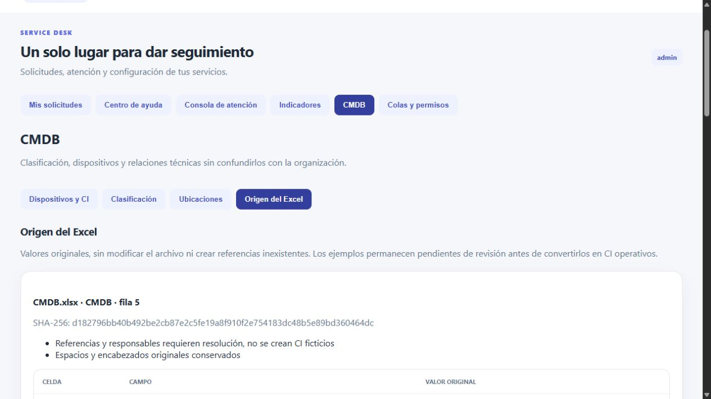

# Cierre técnico y versión de entrega

Fecha: 28 de octubre de 2026, America/Guatemala. Este registro amplía la [verificación P01–P18](service-desk-final.md), no reemplaza ni altera sus salidas históricas.

## Cambios de cierre

- Vista administrativa **CMDB → Origen del Excel**, con las dos filas, 20 campos por fila, hash y coordenadas. Carga repetible de origen también desde la preparación de demostración.
- Prueba de que conservar origen no crea CI ni relaciones ficticias. Comparación de los 40 valores con las celdas originales, conservadas como cadenas de lectura de Excelize, no como tipos nativos de la celda.
- Negativas explícitas de cambio sin aprobación, resolución vacía y cierre sin confirmación, con actor de cierre registrado.
- Build con hashes de originales y búsqueda heurística de claves privadas o tokens. Este control no es una auditoría completa de secretos.
- Cuatro consultas web reales y dos mejoras comparadas en [013–016](../IA.md). Nueve registros de prompts de esta ampliación en total.
- [Guía de defensa](../DEFENSA-SERVICE-DESK.md) y cuentas preparadas, sin subir diapositivas docentes ni mover `parcial-v2.0`.

## Ejecuciones previas al commit

[Runner de cierre](service-desk-cierre-salida.txt), [persistencia](service-desk-cierre-persistencia.txt) y [demostración preservada](service-desk-cierre-demo.txt) terminaron con código 0. Proyecto `catalogo-final-test`, base `catalogo_desk_test`, puertos 18180/18181. La demostración está en `catalogo-service-desk-demo`, base distinta, puerto 18090.

La laptop tenía los contenedores de demostración detenidos al comenzar esta sesión. Se iniciaron sus servicios existentes y se actualizaron API/frontend, conservando volúmenes. El recibo de demostración muestra los mismos digest de tickets e historial antes y después y mantiene 37 tickets, siete colas, ocho FAQ y 5,000 dispositivos. La nueva fuente solo agrega sus dos registros de trazabilidad.

La prueba inicial de origen comprobaba número de filas y campos. Tras la revisión web se amplió para comparar cada valor y los conteos operativos. La ejecución desde clon limpio debe verificar esa ampliación y asociarse al SHA real del código.



## Reproducibilidad del commit

Código funcional publicado en `0b5b8c7762afe85a309e7ad478f35674ef548bc6`. Se clonó directamente desde GitHub en `/home/jeremy/service-desk-clean-CiYU0F`, con `git status --porcelain` vacío. El 28 de octubre de 2026 a las 07:57, America/Guatemala, se ejecutó el runner sobre un proyecto y volúmenes nuevos `catalogo-clean-test`, puertos 18280/18281. Build, hash de originales, búsqueda heurística, pruebas Go/React, readiness y persistencia terminaron con código 0. La comparación de los 40 valores se ejecutó realmente en ese clon.

Comandos de esa ejecución:

```bash
DESK_TEST_PROJECT=catalogo-clean-test DESK_TEST_WEB_PORT=18280 DESK_TEST_API_PORT=18281 bash scripts/service-desk-test.sh
DESK_TEST_PROJECT=catalogo-clean-test DESK_TEST_WEB_PORT=18280 DESK_TEST_API_PORT=18281 bash scripts/service-desk-persistence.sh
```

[Metadatos del clon](service-desk-clon-metadatos.txt), [salida completa](service-desk-clon-salida.txt) y [persistencia desde clon](service-desk-clon-persistencia.txt). En esa base nueva hubo 28 tickets de pruebas, 121 entradas de historial, 5,036 CI incluyendo fixtures, y tres adjuntos, todos conservados tras reinicio. Se observó 34.348701 ms para la consulta paginada y 0.134 ms en el plan SQL, no se presentan como SLA.

Control negativo automatizado: `DESK_TEST_PROJECT=catalogo-service-desk-demo bash scripts/service-desk-test.sh` devolvió 1 antes de ejecutar Docker. [Salida de la protección](service-desk-harness-rechazo-demo.txt). Fue una entrada inválida deliberada y no modificó la demostración.

Se amplió después el recibo P18 para incluir también conteos y digest del catálogo nivel 1 y 2. El commit `461ac0886f7c942b18e23a4a2190abd621d3dba4` se obtuvo desde GitHub y se verificó con el mismo clon sin cambios locales, el 28 de octubre a las 08:01, America/Guatemala. Se repitieron el runner completo y la persistencia con código 0. Esta repetición sobre la misma base también comprueba que los fixtures no dependen de borrar el volumen.

Recibos de esa versión: [SHA y volúmenes efectivos](service-desk-version-verificada-metadatos.txt), [suite completa](service-desk-version-verificada-salida.txt), [P18 ampliada](service-desk-version-verificada-persistencia.txt) y [demostración posterior](service-desk-version-verificada-demo.txt).

| Dato en P18 ampliada | Antes | Después |
| --- | --- | --- |
| Catálogo nivel 1 | 12 | 12 |
| Catálogo nivel 2 | 46 | 46 |
| Tickets temporales de pruebas | 56 | 56 |
| Historial de tickets | 242 | 242 |
| CI, incluidos fixtures no dispositivo | 5,072 | 5,072 |
| Adjuntos | 6 | 6 |

Todos los digest comparados coincidieron. La descarga del adjunto `ticket_id=30`, `attachment_id=4`, conservó sus 30 bytes. La medición de consulta paginada fue 1.803801 ms y la del plan SQL 0.128 ms en esta repetición. La demostración mantuvo sus propios 37 tickets e historial, en el volumen `catalogo-service-desk-demo_desk_demo_data`, distinto de `catalogo-clean-test_desk_test_data`.

El commit posterior que incorpora estos recibos solo cambia documentación y evidencia. El código y scripts verificados son los de `461ac08`, no se atribuye a las salidas un SHA aún desconocido al ejecutarlas.

## Límites que requieren intervención humana

Después de solicitar aclaración, Jeremy respondió: «si no lo viste en las diapositivas no lo enseño». La [decisión de P04](../decisiones/002-interpretacion-cmdb-p04.md) cierra el pendiente documental de obtener un árbol adicional no enumerado. Las pruebas de integridad y el mapeo de información disponible se conservan, con salvedad interpretativa del enunciado. No se atribuyen las seis subclases propias a las fuentes ni se presenta esta respuesta como confirmación directa del catedrático.

Esta actualización es solo documental, posterior a los commits de pruebas identificados arriba. No añade código, no cambia originales y no fabrica una nueva salida de ejecución. Queda por realizar la entrega y defensa por parte del estudiante, no una funcionalidad derivada de un árbol ausente.

No es un requisito expreso tener un editor genérico de esquemas de atributos. Los atributos dependientes de clase sí se validan y editan. Los ejemplos con referencias incompletas no se convierten automáticamente en CI operativos. La entrega en Wedy, la hora límite definitiva y la defensa oral corresponden al estudiante.
