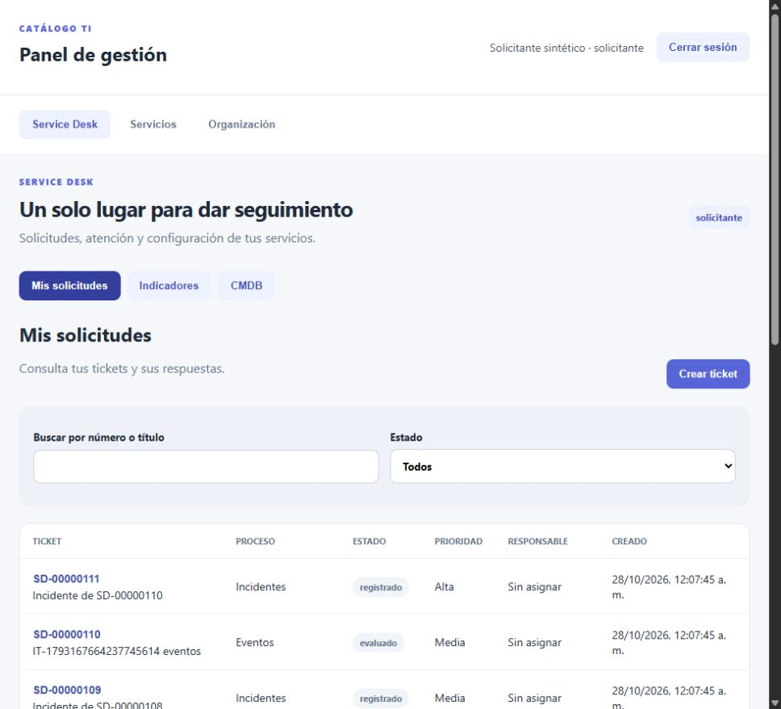
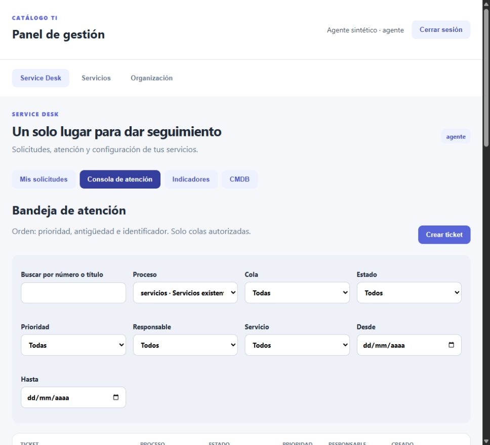
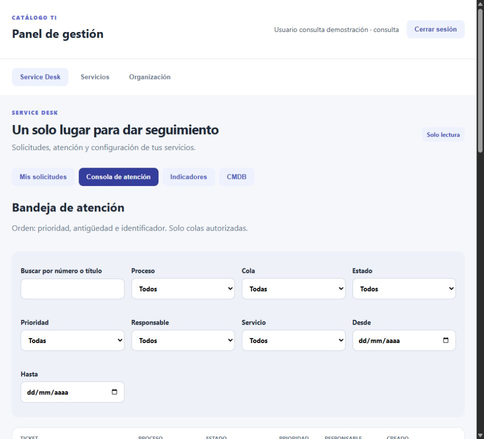
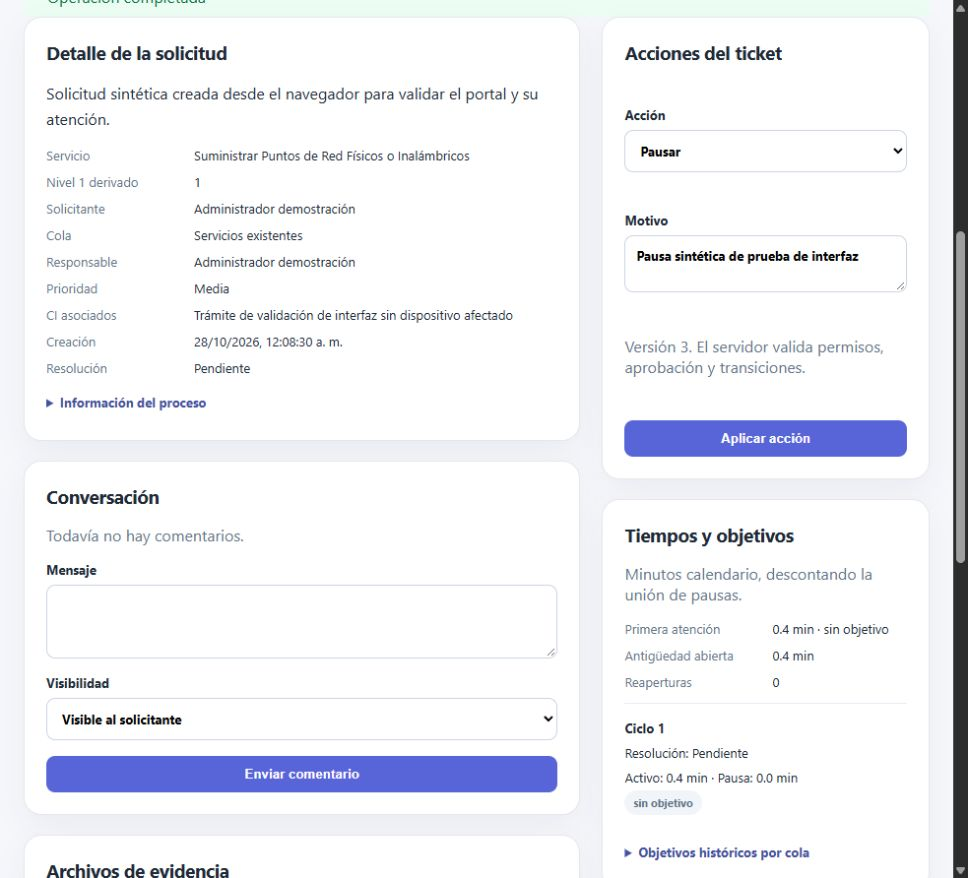
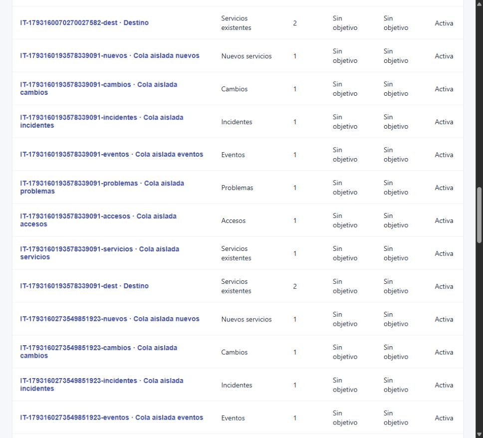
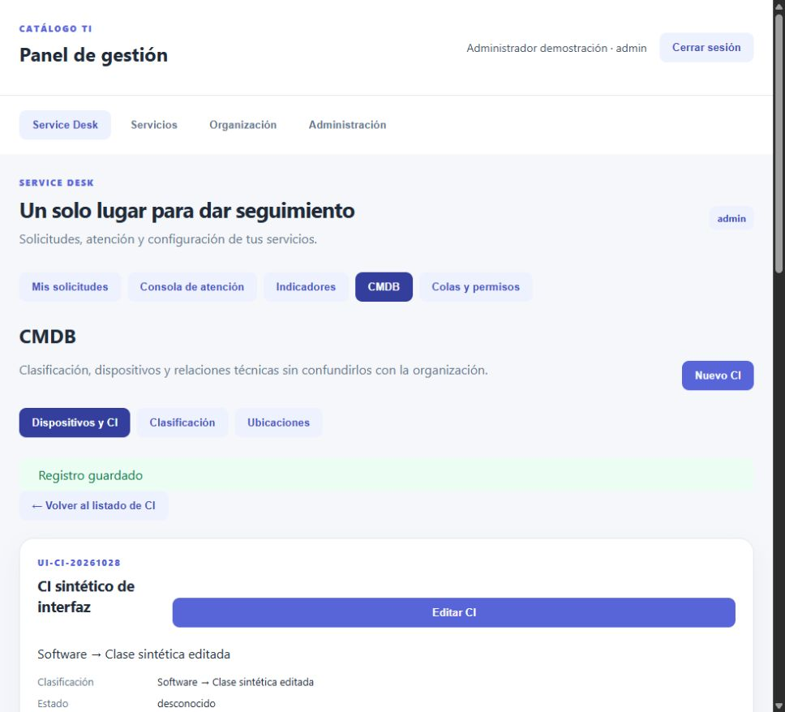
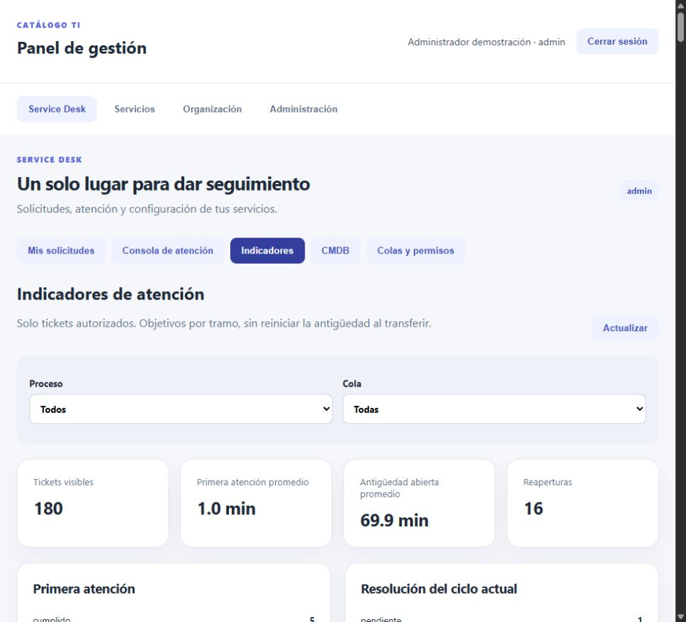
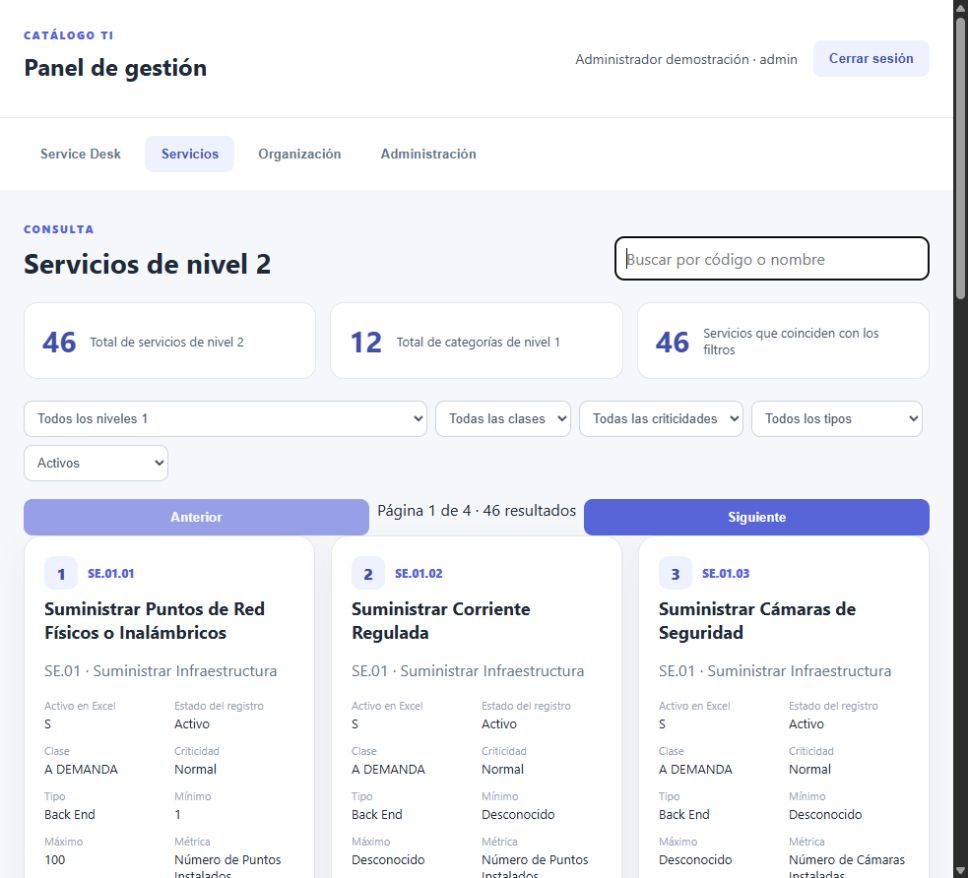

# Indicadores e interfaz, ejecución real

Trabajo iniciado el 27 y verificado el 28 de octubre de 2026, America/Guatemala. Rama `feature/service-desk`, base `55404d1`. La implementación de esta fase está en el worktree y todavía no tiene commit propio. Las capturas y resultados no pertenecen al tag anterior.

## Entorno y controles

Desarrollo local en Windows y ejecución de integración en la laptop Fedora, Podman y PostgreSQL 18. Proyecto separado `catalogo-service-desk-test`, base `catalogo_desk_test`, API interna 8080 y frontend Nginx en puerto de prueba 18080. Se conservaron los volúmenes aislados. No se sobrescribió el repositorio remoto anterior ni se arrancó el entorno del parcial.

La laptop inicialmente no respondió por SSH ni ping. El usuario confirmó que la encendió y se retomó el mismo entorno aislado. Este incidente no se cuenta como un defecto funcional del sistema.

Controles locales aprobados: `go test ./...`, `go vet ./...`, `npm --prefix frontend test`, `npm --prefix frontend run build` y `git diff --check`. La integración local sin variable aislada marca SKIP expresamente. No equivale a PASS de PostgreSQL.

El renderizado automatizado comprueba solicitante, admin, consulta combinada con roles elevados y siete formularios diferenciados. No simula respuestas del servidor ni se presenta como interacción real de navegador. La prueba y el build también se ejecutaron dentro de la imagen frontend.

`npm audit` detectó una dependencia Vite 8.3.2 con un aviso de severidad alta. Se aplicó la actualización compatible del lockfile a Vite 8.3.5 y se repitieron renderizado y build. La auditoría posterior reportó cero vulnerabilidades en esa ejecución, no una garantía futura.

## Integración y P17

Comando ejecutado en la carpeta de fuentes aislada de la laptop:

```bash
bash scripts/service-desk-test.sh
```

[Salida real de la ejecución final](service-desk-indicadores-interfaz-salida.txt). Terminó con código 0. Incluye build, preparación y pruebas. La suite anterior de backend y la de adjuntos también pasaron. La prueba de reinicio de adjuntos queda SKIP en este runner si falta su variable explícita y conserva su evidencia propia anterior, no se declara reejecutada por ese SKIP.

| Caso controlado | Esperado y obtenido |
| --- | --- |
| Resolución de 120 minutos con pausa de 30 | 90 minutos activos |
| Primera atención a los 60 con pausa de 30 | 30 minutos activos |
| Abierto de 60 con pausa abierta de 10 | 50 activos y resolución NULL |
| Pausas solapadas de 30–60 y 45–75 | Unión de 45 minutos, sin doble descuento |
| Frontera del objetivo de 90 | 90 cumple, más de 90 incumple |
| Objetivo desconocido | Sin objetivo, no cumplimiento inventado |
| Cambio de configuración de 90 a 200 | El ciclo existente conserva 90 |
| Reapertura posterior | Nuevo ciclo con 200, resolución anterior intacta y una reapertura |
| Transferencia a cola sin objetivos | Nuevo tramo NULL, tramos anteriores conservados |
| Asignar responsable sin atender | Primera atención sigue NULL |
| Acción de transición durante pausa | Rechazada hasta reanudar |
| Indicadores por tercero sin permiso | Denegados y tablero sin tickets ajenos |
| Baja de cola con ticket pendiente | Rechazada |
| Evidencia posterior a aprobación | Actualización permitida sin cambiar alcance |
| Modificar riesgo aprobado | Rechazado |

Los timestamps históricos del fixture se establecen deliberadamente en la base aislada para obtener valores exactos. No se presentan como tiempos de atención de personas reales ni como una falla introducida en producción.

## Defecto real, corrección y nueva verificación

Objetivo: editar una cola sin alterar los snapshots históricos. La primera integración falló con `record "new" has no field "role"` al actualizar la cola. [Salida real del intento fallido](service-desk-indicadores-primer-intento.txt).

Causa: el trigger compartido de dependencias intentaba resolver `NEW.role`, propio de usuarios, contra un registro de cola. La condición combinada no impedía esa resolución de campos. Se añadió la migración 007 con ramas separadas por tabla, sin reescribir la migración 004 ya publicada.

Evaluación: reconstrucción y repetición contra la misma base aislada. El cambio de objetivos, la protección contra baja con pendientes y las regresiones pasaron. El error no fue deliberado. Las ejecuciones posteriores amplían la regresión con autorización, asignación y evidencias aprobadas. No se cuenta cada recompilación como un prompt o loop distinto.

También se revisó la edición posterior a una aprobación. La prohibición anterior impedía registrar resultados de ejecución. Ahora se permite únicamente la evidencia específica del proceso y se rechaza modificar o eliminar campos de alcance aprobado. Hay prueba unitaria y PostgreSQL, no solo un ajuste visual.

El control adicional de proxy pasó `nginx -t`, pero el sondeo con `localhost` produjo conexión rechazada dentro del contenedor. Se corrigió la dirección del sondeo a `127.0.0.1`, coherente con el listener IPv4, y se repitió el runner. Este fallo del comando de comprobación no se ocultó ni se atribuyó al resultado de P17.

## Recorrido real en navegador

Se utilizó la aplicación real servida por Nginx en `http://192.168.1.23:18080/`, sin mock de API. El recorrido asistido no es una suite E2E exhaustiva de todas las combinaciones.

1. Administrador sintético creó `SD-00000112`, con servicio real del catálogo y justificación sin CI. Tomó, pausó, reanudó y completó el flujo de servicios existentes hasta resuelto y cerrado. La ficha mostró versiones, fechas, primera atención, pausas y resolución.
2. Se creó la cola sintética `UI-20261028` con objetivos 15 y 120. Se editó su nombre, se comprobó la carga de valores al seleccionarla y se desactivó sin tickets. No se alteraron objetivos de colas habituales desde el navegador.
3. Se creó y editó `UI-CLASS-20261028`, bajo Software. Se creó `UI-CI-20261028`, con ubicación y responsable referenciados, sin inventar sus atributos ausentes. Se vinculó un servicio y una dependencia temporal, se navegó al CI relacionado y se comprobó el impacto potencial hacia el CI de prueba. Se retiró solo ese vínculo recién creado y se dieron de baja lógica el CI y su clase de prueba, conservando historial.
4. Solicitante sintético inició sesión y mostró sus tickets, sin consola ni administración. El endpoint del portal filtra por solicitante en el servidor, no solo en React.
5. Consulta inició sesión y abrió la consola en modo solo lectura, sin alta ni administración. El backend conserva además sus pruebas de denegación de escritura.
6. Agente sintético abrió la consola y filtró por servicios existentes. Se visualizaron solo sus colas autorizadas.
7. El tablero presentó conteos, primera atención, antigüedad, reaperturas y estados de objetivos, sin convertir los desconocidos en cumplidos.

## Capturas reales

### Portal del solicitante



### Consola de agente



### Consulta sin escritura



### Ticket, atención y pausa



### Administración de colas



### Ficha de CMDB



### Tablero de indicadores



Las capturas corresponden a momentos del recorrido y sus datos pueden variar al repetir la suite. No contienen un cursor añadido ni respuestas simuladas. Los registros sintéticos conservan su historial en el entorno desechable, no se borró evidencia para aparentar una base limpia.

## Alcance restante

### Ajuste posterior, numeración del catálogo

Por petición del usuario se añadieron posiciones visibles y totales independientes de filtros. Se reconstruyó únicamente el frontend aislado, sin modificar datos ni volver a generar la CMDB. Prueba frontend y build aprobados, además de `nginx -t`. [Salida de la reconstrucción](catalogo-numeracion-salida.txt).

En el navegador se verificaron los números 1–12 en la primera página, 13–24 en la segunda y 37–46 en la última. El encabezado mostró 46 servicios de nivel 2 y 12 categorías de nivel 1. Buscar `SE.12` mostró tres coincidencias, numeradas 1–3, mientras el total global permaneció en 46. Se dejó la búsqueda vacía y la primera página al finalizar.

La primera aserción del selector renderizado encontró comentarios separadores de React en el HTML de SSR. Se normalizaron esos separadores en la prueba, sin cambiar el texto visible ni los valores de las opciones, y se repitió con éxito. No se atribuye ese ajuste del test a un defecto de los datos.



Al registrar esta fase, la FAQ, el dataset de defensa, la correspondencia de fuentes y el cierre P01–P18 todavía necesitaban revisión propia. Es un estado histórico, no la lista vigente de pendientes. Las fases posteriores se documentan en [cierre técnico](service-desk-cierre.md) y la aclaración de P04 en la [decisión de alcance](../decisiones/002-interpretacion-cmdb-p04.md). La persistencia integral no se acredita solo por haber pasado P17 y las capturas no garantizan una calificación.
