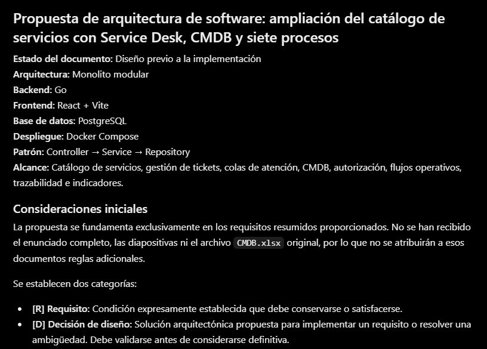

# Diseño previo de Service Desk

Fecha de uso: 2026-10-27. Herramienta de consulta: ChatGPT web. Selector visible: Medium. El identificador exacto del modelo no se verificó y no se infiere de ese rótulo. Elaboración y revisión de documentos: Codex desktop. No se reutilizan los metadatos históricos GPT-5.6 Sol / High como si se hubieran comprobado aquí.

Objetivo: revisar el modelo, permisos, procesos, riesgos y pruebas antes de implementar. Entrada enviada: resumen de requisitos y hallazgos, sin adjuntar archivos ni datos personales o credenciales. La consulta web no tuvo acceso al repositorio ni a los originales.

## Prompt utilizado

Actúa como arquitecto de software con experiencia en Go, PostgreSQL, React y Service Desk. Revisa un diseño previo a la implementación, con énfasis en integridad, autorización y pruebas reproducibles.

Necesito una propuesta para ampliar un catálogo existente con tickets, CMDB y siete procesos diferenciados. Entrega diseño, no código ejecutable ni resultados de pruebas inventados.

El enunciado de la tarea es la referencia principal. Conservaremos autenticación local, contraseñas con hash, bajas lógicas, rol de consulta sin escritura, jerarquía Empresa → Área → Departamento → Sección → Puesto → Usuario y catálogo de dos niveles. La importación conserva 12 códigos de nivel 1 y 46 servicios de nivel 2, conflicto SE.12 trazable y atributos desconocidos. Arquitectura: monolito modular Controller → Service → Repository, Go, React/Vite, PostgreSQL y Docker Compose. No se requiere KEDB independiente. Las diapositivas no se adjuntan ni deben reproducirse. No afirmes que has leído archivos que no te proporcioné.

Usa como entrada estos requisitos resumidos: tickets con solicitante y creador, servicio nivel 2 y nivel 1 derivado, tipo, proceso, cola, responsable, estado, prioridad, impacto, urgencia, canal, fechas, resolución, comentarios públicos y notas internas, adjuntos con tamaño/tipo/descarga autorizada, historial de actor y valores antes/después, relaciones entre tickets y CI opcionales con justificación. Colas con exactamente un proceso, roles o usuarios autorizados, permisos separados para consultar, atender, transferir, aprobar y administrar, orden determinista y reclamación concurrente por un solo agente. Procesos: nuevos servicios, cambios, incidentes, eventos, problemas, accesos y servicios existentes. Cambios requieren aprobación, riesgo, pruebas y reversión. Accesos prohíben autoaprobación. Eventos E0/E1 no generan incidentes automáticamente, E2/E3 requieren incidente y notificación verificable sin duplicación. Incidentes I0–I6 conservan duración, prioridad y redundancia, con regla complementaria explícita para intervalos solapados y huecos, sin convertirlos en SLA. CMDB.xlsx tiene únicamente dos ejemplos Hardware/Software y 20 campos: nombre, tipo, descripción, serie, versión, adquisición, estado, relaciones, padres/hijos, ubicación, propietario, fecha y descripción de cambio, documentación, enlaces a incidentes/problemas, seguridad, cumplimiento, estado de configuración, licencia y vencimiento. No define una taxonomía completa. Referencia Base de Datos1 sin registro y ubicación de aplicación Servidor1 requieren revisión, no creación automática. Se exigen 5,000 dispositivos sintéticos persistidos, semilla configurable e idempotencia, siete colas, 35 tickets (cinco por proceso), roles administrador/solicitante/agente/aprobador/consulta, FAQ, portal, consola e indicadores con pausas y reaperturas. Los nuevos P01–P18 cubren permisos, importación, generación, jerarquía, tickets, colas, concurrencia, transferencias, siete rutas, aprobaciones, eventos, incidentes, vínculos problema/cambio, dependencias, cierre/reapertura, paginación/rendimiento, indicadores y persistencia.

Responde en español con: 1) riesgos y ambigüedades, 2) entidades y relaciones con claves y restricciones, 3) matriz breve de siete procesos con estados y condiciones, 4) autorización y concurrencia, 5) propuestas explícitas para clasificación CMDB y tiempos, 6) matriz de pruebas y orden de implementación. Distingue requisitos de decisiones del proyecto. Incluye cómo contar solo dispositivos y recorrer dependencias sin equiparar dependencia con interrupción efectiva.

Aceptaré la propuesta si preserva la base, no inventa una jerarquía atribuida al Excel, diferencia los siete flujos, impide autoaprobación y doble reclamación, protege consulta y adjuntos, contempla las cantidades y P01–P18, define indicadores comprobables y reconoce que todo sigue pendiente de implementar y probar.

## Respuesta real y captura

[Conversación generada](https://chatgpt.com/c/6ae16c49-7d24-83e8-af2b-52d2346864ae). No es un enlace público de compartir y puede requerir la cuenta autorizada. La captura y extractos seleccionados son la evidencia accesible en el repositorio.

Extracto literal del comienzo:

> Estado del documento: Diseño previo a la implementación
>
> Arquitectura: Monolito modular
>
> Patrón: Controller → Service → Repository

La respuesta distinguió requisitos y decisiones de diseño, propuso permisos efectivos en servidor, reclamación transaccional y preservación de referencias no resueltas. Reconoció expresamente que solo recibió un resumen, no el enunciado completo ni el Excel. Señaló que faltaban umbrales numéricos originales de incidentes en el prompt. Esa limitación se resolvió contrastando directamente el enunciado para redactar PROCESOS.md, no fingiendo que la consulta web había leído los originales.

Captura real de la página, recortada únicamente en sus bordes para enfocar el inicio de la respuesta. No se añadió ni reconstruyó texto dentro de la imagen. La mención de archivos no recibidos forma parte de la respuesta real, no es una reproducción de presentaciones.

## Revisión y decisiones aplicadas

Se incorporaron al [modelo](../MODELO.md), [procesos](../PROCESOS.md) y [plan de pruebas](../PRUEBAS.md) la separación del ticket central y detalles específicos, autorización por cola, control concurrente, conservación de ciclos y distinción entre dependencia e interrupción.

No se copió toda la propuesta sin revisión. La clasificación propuesta se distingue como propia, las ausencias siguen siendo desconocidas y los objetivos configurados sí requieren indicador aunque no constituyan SLA contractual. El conjunto de demostración se planificó con 37 tickets para cubrir siete categorías de incidentes y al menos cinco por proceso. Las restricciones SQL y API existentes se revisaron para evitar presentar roles múltiples como ya implementados.

Un intento anterior en otro chat falló con `cloudflare_challenge` sin respuesta. Tras intervención del usuario se abrió un chat nuevo y se realizó este envío, que sí generó una respuesta. No se cuenta esa recuperación de acceso como mejora del prompt ni como loop funcional de la aplicación.

## Criterio y estado de aceptación

La revisión produjo documentos con decisiones explícitas y matriz P01–P18. Faltan implementación, verificación funcional y revisión final de decisiones por el usuario. La respuesta y captura no prueban que los requisitos estén ejecutados. Este es un prompt nuevo de diseño, no ocho prompts ni dos iteraciones de mejora completadas.
