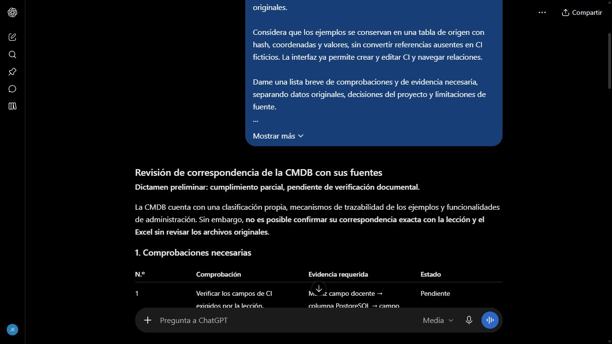

# Revisión de CMDB para el cierre

Fecha de envío: 28 de octubre de 2026. Herramienta: ChatGPT web. Selector visible Medium, identificador de modelo no verificado. Consulta de revisión, no acceso al repositorio ni a archivos originales.

## Prompt utilizado

Actúa como revisor de un Service Desk en Go, React y PostgreSQL.

Necesito revisar qué falta para demostrar correspondencia de la CMDB con sus fuentes, sin inventar datos.

El sistema tiene una clasificación con Hardware y Software y seis subclases técnicas propias. La tarea exige correspondencia con una lección y con un Excel. La lección describe campos y relaciones, pero no enumera un árbol de dispositivos. El Excel contiene dos ejemplos y referencias incompletas. Esta consulta no adjunta los archivos originales.

Considera que los ejemplos se conservan en una tabla de origen con hash, coordenadas y valores, sin convertir referencias ausentes en CI ficticios. La interfaz ya permite crear y editar CI y navegar relaciones.

Dame una lista breve de comprobaciones y de evidencia necesaria, separando datos originales, decisiones del proyecto y limitaciones de fuente.

Aceptaré la revisión si no atribuye la clasificación propia al material docente y no afirma aprobar un requisito cuya correspondencia exacta no puede comprobarse con esta información.

## Respuesta y evaluación

[Conversación real](https://chatgpt.com/c/6ae1fcf4-fb14-83e8-8b64-99da824014d5). Se envió el mensaje anterior sin adjuntar archivos.

La respuesta pidió matriz de campos, relaciones, coordenadas e integridad. Mantuvo la correspondencia exacta pendiente porque no recibió las fuentes. Sin embargo, clasificó Hardware y Software como decisiones propias. La entrada inicial no indicaba sus celdas y permitió esa imprecisión. Se corrigió el contexto en el [prompt 014](014-revision-cmdb-refinada.md), sin aceptar automáticamente esa conclusión del modelo.

