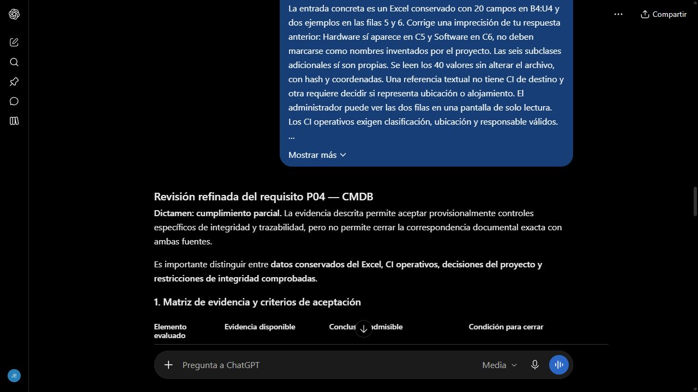

# Revisión refinada de fuentes CMDB

Fecha de envío: 28 de octubre de 2026. Herramienta: ChatGPT web. Selector Medium, modelo exacto no verificado.

## Prompt utilizado

Actúa como revisor de trazabilidad e integridad de una CMDB.

Refina la revisión anterior para decidir qué evidencia sí permite aceptar y qué debe continuar parcial. No diseñes una taxonomía nueva.

El requisito P04 pide correspondencia con dos fuentes y rechazo de padres inexistentes y ciclos. Ya existen pruebas reales de padre inválido, ciclo indirecto y carrera concurrente A→B y B→A. No hay una enumeración docente verificable de las seis subclases técnicas propias.

La entrada concreta es un Excel conservado con 20 campos en B4:U4 y dos ejemplos en las filas 5 y 6. Corrige una imprecisión de tu respuesta anterior: Hardware sí aparece en C5 y Software en C6, no deben marcarse como nombres inventados por el proyecto. Las seis subclases adicionales sí son propias. Se leen los 40 valores sin alterar el archivo, con hash y coordenadas. Una referencia textual no tiene CI de destino y otra requiere decidir si representa ubicación o alojamiento. El administrador puede ver las dos filas en una pantalla de solo lectura. Los CI operativos exigen clasificación, ubicación y responsable válidos. No se adjuntan fuentes a esta consulta.

Responde con una tabla de evidencia disponible, conclusión admisible y condición para cerrar la parte todavía incierta. Incluye dos pruebas automáticas adicionales que no inventen referencias ni cambien los originales.

La revisión será útil si mantiene separadas la integridad comprobada y la fidelidad documental no confirmada, y si deja claro que mostrar una fila original no equivale a haberla importado como CI operativo.

## Respuesta y evaluación

[Conversación real](https://chatgpt.com/c/6ae1fcf4-fb14-83e8-8b64-99da824014d5), segundo envío de esta revisión.

La respuesta reconoció Hardware y Software como valores de C5/C6 y separó las seis subclases propias. Conservó P04 parcial y aclaró que mostrar valores originales no prueba su conversión en CI operativos. Propuso comparar los 40 valores y comprobar que importar/consultar el origen no genere CI ni relaciones.

Aplicación comprobable: `CMDB_original_rows_and_readonly_review` compara cada valor con su celda del libro original, repite la carga y verifica conteos operativos invariantes. `TestSourceIntegrity` comprueba SHA-256. La vista administrativa de origen permite revisar las dos filas sin editarlas. No se declara fidelidad completa de una jerarquía no enumerada.

Mejora respecto al 013: se añadió ubicación concreta y se corrigió una atribución errónea del resultado anterior. Criterio de salida: valores contrastados e integridad verificada, con limitación documental visible.

Nota posterior: el dictamen parcial es parte de la respuesta real recibida antes de la aclaración de Jeremy. El [cierre documental de P04](../decisiones/002-interpretacion-cmdb-p04.md) registra la decisión posterior con salvedad interpretativa. No se cambia el prompt ni se modifica la respuesta o su captura para aparentar otra conclusión del modelo.
