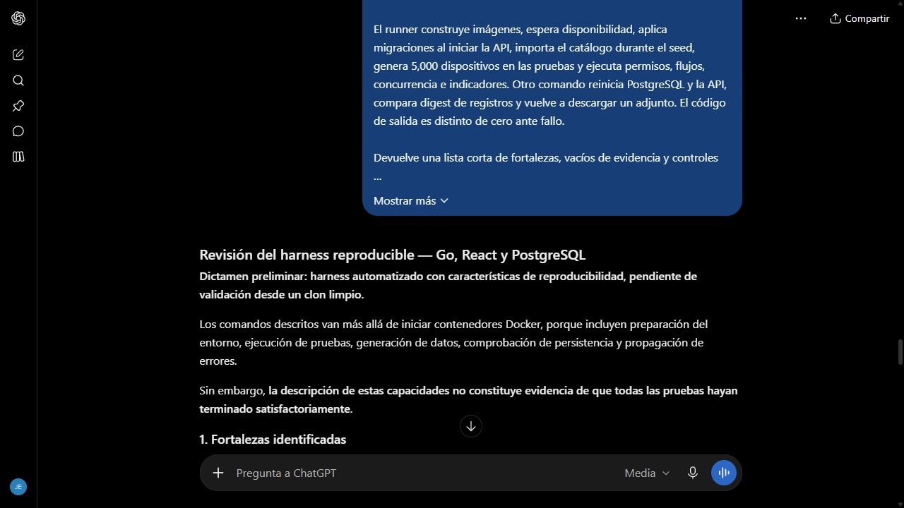

# Revisión del harness de cierre

Fecha de envío: 28 de octubre de 2026. Herramienta: ChatGPT web. Selector Medium, modelo exacto no verificado.

## Prompt utilizado

Actúa como revisor de pruebas automatizadas de una aplicación Go y React con PostgreSQL.

Necesito evaluar si mis comandos constituyen un harness reproducible y no solamente un arranque con Docker.

El sistema extiende un catálogo con Service Desk. Hay una demostración de 37 tickets y una base separada para pruebas. No deben perderse los datos de evaluación ni exigirse Go o Node instalados en el anfitrión.

El runner construye imágenes, espera disponibilidad, aplica migraciones al iniciar la API, importa el catálogo durante el seed, genera 5,000 dispositivos en las pruebas y ejecuta permisos, flujos, concurrencia e indicadores. Otro comando reinicia PostgreSQL y la API, compara digest de registros y vuelve a descargar un adjunto. El código de salida es distinto de cero ante fallo.

Devuelve una lista corta de fortalezas, vacíos de evidencia y controles que debería verificar desde un clon limpio.

Aceptaré observaciones que distingan propuestas de resultados reales, no pidan borrar volúmenes para pasar las pruebas y no concluyan que Docker por sí solo demuestra el harness.

## Respuesta y evaluación

[Conversación real](https://chatgpt.com/c/6ae1fcf4-fb14-83e8-8b64-99da824014d5), tercer envío.

La respuesta distinguió un harness de un simple arranque y pidió demostrar reproducibilidad, aislamiento y propagación de fallos. Señaló que solo había recibido una descripción del runner, no resultados auditados ni un clon nuevo.

Limitación de la instrucción: no incluía nombres de proyectos, semilla, separación de SKIP/PASS ni salida observada de persistencia. La [revisión 016](016-revision-harness-refinada.md) incorpora ese contexto verificable y conserva pendiente la ejecución del SHA publicado desde un clon limpio.

