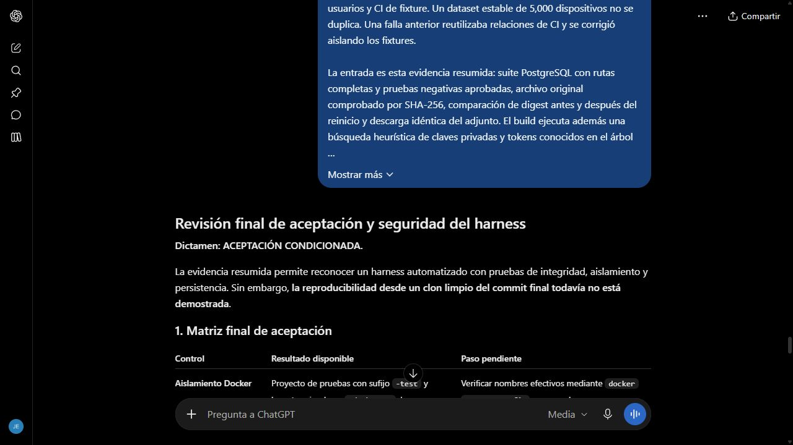

# Revisión del harness con resultados concretos

Fecha de envío: 28 de octubre de 2026. Herramienta: ChatGPT web. Selector Medium, modelo exacto no verificado.

## Prompt utilizado

Actúa como revisor de aceptación y seguridad de un harness en contenedores.

Refina la revisión anterior con estas restricciones y resultados concretos. No generes una salida de consola ficticia ni des por verificado un commit que no se haya ejecutado.

El proyecto de pruebas debe terminar en -test y usar base terminada en _desk_test. La demostración tiene otro proyecto, otra base, otros volúmenes y otros puertos. Cada ejecución crea sus propias colas, usuarios y CI de fixture. Un dataset estable de 5,000 dispositivos no se duplica. Una falla anterior reutilizaba relaciones de CI y se corrigió aislando los fixtures.

La entrada es esta evidencia resumida: suite PostgreSQL con rutas completas y pruebas negativas aprobadas, archivo original comprobado por SHA-256, comparación de digest antes y después del reinicio y descarga idéntica del adjunto. El build ejecuta además una búsqueda heurística de claves privadas y tokens conocidos en el árbol fuente. Esa búsqueda no es una auditoría completa de secretos. La prueba de persistencia se omite en el runner general sin su variable explícita y se ejecuta en un comando separado. Falta asociar la repetición desde clon limpio al commit final real.

Entrega una lista final de aceptación con control, resultado disponible y paso pendiente. Sugiere una explicación oral de cuatro frases sobre cómo demostrar el harness y dónde reconocer sus límites.

Aceptaré el resultado si separa SKIP de PASS, no confunde los 37 tickets de defensa con los temporales de pruebas y mantiene pendiente cualquier fidelidad documental sin fuente confirmada.

## Respuesta y evaluación

[Conversación real](https://chatgpt.com/c/6ae1fcf4-fb14-83e8-8b64-99da824014d5), cuarto envío.

La respuesta distinguió PASS, FAIL y SKIP, reconoció los controles descritos y mantuvo pendiente la ejecución del commit publicado desde un clon limpio. Aclaró que su dictamen parte del resumen recibido, no de una auditoría directa del repositorio. No propuso borrar los datos preparados ni rediseñar el harness.

Mejora respecto al 015: se incorporaron sufijos de aislamiento, semilla, fixture corregido, control heurístico y la diferencia entre omisión general y prueba explícita de persistencia. La salida ahora separa evidencia disponible y el único paso de reproducibilidad todavía no ejecutado en el momento de la consulta.

Aplicación: ejecutar el SHA real desde clon nuevo, conservar el estado limpio y la salida de los runners. El resultado verificable se documenta en [cierre técnico](../evidencias/service-desk-cierre.md), no se toma la aprobación del modelo como resultado de las pruebas.

